<div align="center">

# 🛰️ PEER'S OSINT SCANNER
### *Automated Passive Reconnaissance & Domain Intelligence Engine*

[](https://www.python.org/)
[](https://github.com/MdPeerSiddiqui/Peers-Osint-Scanner)
[](https://github.com/MdPeerSiddiqui/Peers-Osint-Scanner)
[](LICENSE)
[](https://github.com/MdPeerSiddiqui/Peers-Osint-Scanner/actions)

<p align="center">
  <b>Developed by <a href="https://github.com/MdPeerSiddiqui">Md Peer Siddiqui</a> under the Sqrock IT Solution Alpha 2 Internship Program</b>
</p>

---

### 🖥️ Animated Terminal Demo
*(See how PEER'S Scanner fingerprint targets in real-time with zero intrusion)*

<p align="center">
  
</p>

---

</div>

## 📌 What is PEER'S OSINT Scanner?

**PEER'S OSINT Scanner** is an open-source, passive reconnaissance and intelligence-gathering CLI tool built in Python. Designed for security researchers, penetration testers, and defenders, it extracts critical infrastructure metadata, DNS routing records, WHOIS registry information, and geographical metrics on any target **Domain** or **IPv4/IPv6 Address** without generating alert traffic on the target's internal network.

---

## ⚡ Core Capabilities

| Feature | Description |
| :--- | :--- |
| 🌐 **Dual Target Recognition** | Intelligently differentiates between FQDNs (e.g., `google.com`) and raw IP addresses (e.g., `8.8.8.8`). |
| 📡 **DNS & Reverse PTR** | Resolves forward IPv4 A records and performs reverse DNS PTR hostname resolution. |
| 📜 **Deep WHOIS Intelligence** | Pulls authoritative registrar details, creation timestamps, renewal/expiration dates, and NameServers. |
| 🌍 **Geolocation & ASN Metrics** | Queries geographic coordinates, city, region, country code, ISP provider, and Autonomous System Numbers. |
| 🛡️ **Passive Security Fingerprinting** | Identifies external WAF/CDN proxies (Cloudflare) and cloud hosting infrastructure (AWS, Google Cloud). |
| 💾 **Automated JSON Deliverables** | Auto-generates structured, audit-ready deliverables in the `reports/` folder. |

---

## 🚀 Step-by-Step Installation & Usage

Follow these simple steps to install and run **PEER'S OSINT Scanner** in under 60 seconds:

### Step 1: Clone the Repository
Open your terminal and clone the repository:
```bash
git clone https://github.com/MdPeerSiddiqui/Peers-Osint-Scanner.git
cd Peers-Osint-Scanner
```

### Step 2: Set Up Virtual Environment (Recommended)

#### On Windows (PowerShell / Command Prompt):
```powershell
python -m venv .venv
.\.venv\Scripts\activate
```

#### On Linux / macOS:
```bash
python3 -m venv .venv
source .venv/bin/activate
```

### Step 3: Install Required Dependencies
```bash
pip install -r requirements.txt
```

*(Optional: Install globally as an executable command)*:
```bash
pip install -e .
# You can now type 'peers-scanner google.com' anywhere in your terminal!
```

---

## 🎮 How to Run

### Method 1: Interactive Prompt (Easiest)
Simply run the script with no arguments:
```bash
python peers_scanner.py
```
You will be greeted by the cyber banner and asked:
```text
[?] Enter Target Domain or IP Address
    └── Target > google.com
```

### Method 2: Direct Command-line Execution
Scan any domain or IP instantly by passing it directly:
```bash
# Scan a domain name
python peers_scanner.py google.com

# Scan an IPv4 address directly
python peers_scanner.py 8.8.8.8
```

### Method 3: Internship Suite Master Launcher
To test and access the complete 15-day cybersecurity curriculum:
```bash
python main.py
```

---

## 📂 Project Architecture

The directory structure is organized with clean separation of code, documentation, and reports:

```text
Peers-Osint-Scanner/
│
├── peers_scanner.py               # 🚀 Main Standalone PEER'S OSINT Scanner
├── main.py                        # 🎛️ Master 15-Day Internship Suite Runner
├── setup.py                       # 📦 Package configuration for global CLI install
├── requirements.txt               # 📋 Python dependencies
├── README.md                      # 📖 GitHub showcase & documentation
├── LICENSE                        # ⚖️ MIT Open Source License
│
├── assets/
│   └── terminal_demo.svg          # 🎥 Animated live terminal demo
│
├── modules/                       # 🧩 Modular curriculum packages
│   ├── day01_osint/               # [Day 1] Core OSINT Scanner Module
│   ├── day02_email_harvesting/    # [Day 2] Email Harvesting & Regex Scraper
│   ├── day03_phishing_detector/   # [Day 3] URL Phishing Risk Scorer
│   └── ...                        # Days 04 to 15
│
├── reports/                       # 📊 Exported audit deliverables & JSON reports
│   ├── day01_osint_report.md      # Official 1-page internship report
│   ├── peers_scan_google.com.json # Live Google scan report
│   └── peers_scan_8.8.8.8.json    # Live Public DNS scan report
│
├── screenshots/                   # 📸 Practical Proof of Execution (Terminal & Code)
│
└── docs/                          # 📜 Guides and Trackers
    ├── ETHICAL_GUIDELINES.md      # Legal compliance (IT Act 2000, CFAA, GDPR)
    ├── PROGRESS_TRACKER.md        # 15-Day internship roadmap checklist
    └── LINKEDIN_SHOWCASE_GUIDE.md # Proven blueprint for LinkedIn portfolio posts
```

---

## 🛡️ Attacker vs. Defender Security Value

| Security Dimension | Attacker Perspective | Defender Perspective |
| :--- | :--- | :--- |
| **Registrar & Expiration** | Identifies forgotten domains for hijacking/subdomain takeovers and typosquatting attacks. | Enforces auto-renewals, registry locks, and WHOIS privacy protection. |
| **DNS & Host Routing** | Finds origin IP addresses hidden behind CDNs to bypass WAF defenses. | Implements Cloudflare Authenticated Origin Pulls to hide backend server IPs. |
| **Geolocation & ASN** | Identifies geographic jurisdiction to target local banking or government pretexts. | Applies IP geo-blocking and network segmentation on internal assets. |

---

## 🏛️ Internship Attribution
This project was designed and implemented by **[Md Peer Siddiqui](https://github.com/MdPeerSiddiqui)** as part of the **Alpha 2 Internship — Cybersecurity Track (Phase 1)** organized by **Sqrock IT Solution**.

---

## ⚖️ Legal & Ethical Notice
**FOR EDUCATIONAL, RESEARCH, AND AUTHORIZED AUDITING ONLY.**  
This tool utilizes publicly available, non-intrusive DNS and WHOIS protocols. It does not perform port exploitation, denial of service, or unauthorized packet injection. All users must comply with the Indian Information Technology Act (2000), US Computer Fraud and Abuse Act (CFAA), and applicable local cyber laws.

---

<div align="center">
  <sub>Built with ❤️ by Md Peer Siddiqui • Powered by Sqrock IT Solution</sub>
</div>
